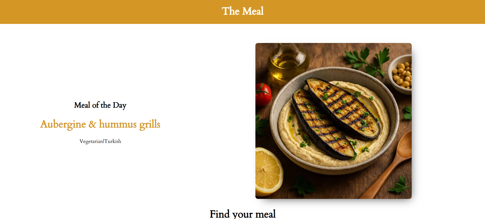

# 🍽️ neobis_front_themeal

**The Meal — Recipe Finder**

**neobis_front_themeal** — шестой Frontend-проект, разработанный в рамках профессиональной стажировки в **Neobis**.

Проект представляет собой веб-приложение для поиска и просмотра кулинарных рецептов. Пользователи могут знакомиться с доступными блюдами, просматривать информацию о рецептах и переходить между страницами приложения.

Данные рецептов загружаются из базы данных через Backend, что позволяет отображать актуальную информацию в пользовательском интерфейсе.

---

## 📸 Screenshots



---

## ✨ Features

- 🍳 **Recipe Catalog** — просмотр доступных кулинарных рецептов.
- 🔎 **Recipe Search** — поиск интересующих рецептов.
- 📖 **Recipe Details** — просмотр подробной информации о блюдах.
- 🧭 **Page Navigation** — переход между страницами приложения с помощью React Router DOM.
- ⚛️ **Reusable Components** — использование переиспользуемых React-компонентов.
- 🔄 **Dynamic Content** — отображение данных, полученных из базы данных.
- 🎨 **Interactive UI** — удобный и понятный пользовательский интерфейс.

---

## 🛠 Tech Stack

| Technology | Purpose |
|---|---|
| React.js | Создание пользовательского интерфейса |
| JavaScript (ES6+) | Клиентская логика приложения |
| React Router DOM | Маршрутизация и навигация между страницами |
| HTML5 | Структура компонентов |
| CSS3 | Стилизация интерфейса |
| npm | Управление зависимостями и запуск проекта |

---

## 🏗 Architecture

Приложение построено на основе компонентной архитектуры React.

Основной файл `App.js` отвечает за общую структуру приложения и подключение основных компонентов.

В процессе разработки использовались:

- **Functional Components** — создание функциональных компонентов React.
- **Component-Based Architecture** — разделение интерфейса на независимые компоненты.
- **React Router DOM** — настройка маршрутов и навигации между страницами.
- **Props** — передача данных между компонентами.
- **React Hooks** — работа с состоянием и логикой компонентов.
- **CSS Styling** — отдельные стили для компонентов.

---

## 🧠 What I Learned

В ходе разработки проекта я получил практический опыт:

- Создания React-приложений с нуля.
- Построения компонентной архитектуры.
- Работы с React Router DOM.
- Настройки маршрутизации и переходов между страницами.
- Разделения приложения на компоненты и их стили.
- Получения и отображения данных из Backend.
- Организации структуры React-проекта.
- Разработки интерактивного пользовательского интерфейса.

---

## 💻 Installation & Setup

Для локального запуска проекта выполните следующие шаги.

### 1. Clone the repository

```bash
git clone <REPOSITORY_URL>
```

### 2. Navigate to the project directory

```bash
cd neobis_front_themeal
```

### 3. Install dependencies

```bash
npm install
```

### 4. Start the development server

```bash
npm start
```

После успешного запуска приложение будет доступно в браузере по адресу:

[http://localhost:3000](http://localhost:3000)

---

## 👨‍💻 About the Project

**Developer:** Дастан Алмазбеков

**Role:** Frontend Developer

**Organization:** Neobis

**Project Number:** 6th Internship Project

**Project Type:** Recipe Finder Web Application

**Main Focus:** React, React Router DOM, Component Architecture

---

## 🔗 Live Demo

[Мощный сайт](https://neobis-front-themeal-livid.vercel.app/)

---

⭐ Thanks for checking out my project!
